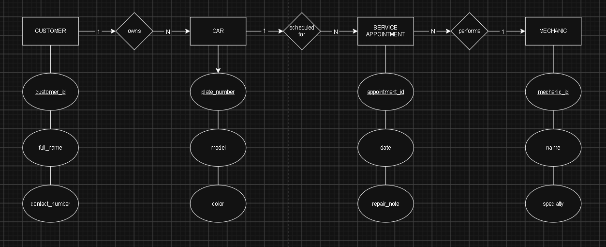

# INFOMAN1 — Week 2 Lab Output

**Name:** Red Cyrus Oloresisimo
**Student ID:** 2510818
**Section:** BSIT-II

---

## Task 1 — Candidate Entities

| Entity | Justification |
|---|---|
| `Customer` | The scenario states "the shop has many **customers**," making Customer a core, independently identifiable entity with its own data (not just a descriptor of another entity). |
| `Car` | The scenario states "each customer may bring in one or more **cars** for repair" and each car has distinct attributes (model, plate number, color), confirming it is a standalone entity. |
| `Mechanic` | The scenario states "the shop employs several **mechanics**, each with a name and a specialty," establishing Mechanic as an independent entity with unique identifying information. |
| `Service Appointment` | The scenario describes "a scheduled **service appointment**" with its own date and repair note, and it serves as the associative entity resolving the many-to-many relationship between Car and Mechanic. |

---

## Task 2 — Attributes, Primary Keys & Domains

### Customer
- **`customer_id`** *(Primary Key)* — Domain: positive integer, auto-incremented, unique per customer
- **`full_name`** — Domain: string (alphabetic characters and spaces, max 100 chars)
- `contact_number` — Domain: string (numeric digits, 10–15 chars, e.g. phone number)

### Car
- **`car_id`** *(Primary Key)* — Domain: positive integer, auto-incremented, unique per car
- **`plate_number`** — Domain: string (alphanumeric, format per local LTO standard, e.g. `ABC 123`)
- `model` — Domain: string (alphanumeric, e.g. "Toyota Vios 2020", max 100 chars)
- `color` — Domain: string (alphabetic, e.g. "Red", "Metallic Gray", max 50 chars)

### Mechanic
- **`mechanic_id`** *(Primary Key)* — Domain: positive integer, auto-incremented, unique per mechanic
- **`name`** — Domain: string (alphabetic characters and spaces, max 100 chars)
- `specialty` — Domain: string from an enumerated set (e.g. `engine`, `brakes`, `electrical`, `transmission`)

### Service Appointment
- **`appointment_id`** *(Primary Key)* — Domain: positive integer, auto-incremented, unique per appointment
- **`date`** — Domain: valid calendar date (DATE type, format YYYY-MM-DD, no future limit)
- `repair_note` — Domain: string (free text, max 500 chars describing the repair performed)

---

## Task 3 — Relationships & Cardinality

| Relationship | Verb Phrase | Cardinality | Proof (Both Directions) |
|---|---|---|---|
| Customer → Car | **owns** | `1:N` | One **Customer** can own many **Cars**; each **Car** belongs to exactly one **Customer** (scenario: "belongs to exactly one customer"). |
| Car → Service Appointment | **scheduled for** | `1:N` | One **Car** can have many **Service Appointments** (scenario: "one car may be serviced by different mechanics on different visits"); each **Service Appointment** is for exactly one **Car**. |
| Mechanic → Service Appointment | **performs** | `1:N` | One **Mechanic** can perform many **Service Appointments** (scenario: "one mechanic may work on many different cars over time"); each **Service Appointment** is performed by exactly one **Mechanic**. |

> **Note:** The M:N relationship between Car and Mechanic (a car can be serviced by many mechanics; a mechanic can service many cars) is resolved by the `Service Appointment` associative entity, decomposing it into two 1:N relationships.

---

## Task 4 — Conceptual ERD

