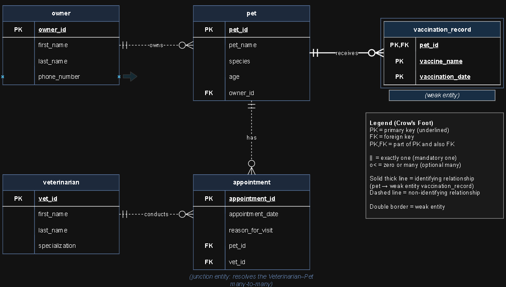

# INFOMAN1 — Week 3 Lab Answers
**Name:** Red Cyrus Oloresisimo
**Student ID:** 2510818
**Section:** BSIT-II

## Task 1 — Classify Attributes and Identify Weak Entities

1. **Composite Attributes:**
    * `full_name` (Owner): the scenario says it is "consisting of first name and last name", so it is split into `first_name` and `last_name`.
    * `full_name` (Veterinarian): the same decomposition applies, giving `first_name` and `last_name`.

2. **Multivalued Attributes:**
    * Vaccination history (Pet): a pet can have many vaccine name and date pairs, which cannot fit in one column. It is resolved into the separate weak entity `vaccination_record`.

3. **Derived Attributes:**
    * `age` (Pet): age can be derived from a birth date (CURRENT_DATE − birth_date). The scenario lists `age` as a stored attribute, so it is kept in the schema. The trade-off is that a stored age becomes outdated over time.

4. **Simple (single-valued) Attributes:**
    * `phone_number`, `species`, `specialization`, `appointment_date`, `reason_for_visit`: each holds one atomic value.

5. **Weak Entity Identification:**
    * Vaccination Record is a weak entity. By the standard definition, a weak entity has no primary key of its own and depends on an owner (strong) entity through an identifying relationship.
    * **Existence dependency:** the scenario says it "only makes sense in relation to the specific pet it belongs to", so it cannot exist without a Pet.
    * **No standalone primary key:** `vaccine_name` and `vaccination_date` repeat across pets, and the scenario says it "cannot be uniquely identified or looked up on its own".
    * **Identifying relationship and partial key:** it is identified through its identifying relationship with Pet. Its PK is the parent key `pet_id` plus the partial key (`vaccine_name`, `vaccination_date`).
    * **Why the date is in the partial key:** the same vaccine (for example, a booster) can be given to the same pet on different dates.

## Task 2 — Specify Cardinality & Participation

The symbol nearest the entity is the **outer** symbol (cardinality). The symbol farther away is the **inner** symbol (participation).

1. **Owner – Pet**
    * Rule: an owner may have zero or many pets ("is not required to have any pets on file"). Each pet belongs to exactly one owner ("every pet must belong to exactly one owner").
    * OWNER end: outer `|` (one) + inner `|` (mandatory) = `||`, exactly one.
    * PET end: outer `<` (many) + inner `o` (optional) = `o<`, zero or many.

2. **Pet – Appointment**
    * Rule: each appointment specifies exactly one pet ("exactly one pet — an appointment cannot exist without both").
    * PET end: outer `|` (one) + inner `|` (mandatory) = `||`.
    * APPOINTMENT end: outer `<` (many) + inner `o` (optional) = `o<`.
    * **Assumption:** the scenario never says a pet must have an appointment, so a pet may have zero or many.

3. **Veterinarian – Appointment**
    * Rule: a veterinarian "can conduct multiple appointments over time or none at all". Each appointment must specify "exactly one veterinarian".
    * VETERINARIAN end: outer `|` (one) + inner `|` (mandatory) = `||`.
    * APPOINTMENT end: outer `<` (many) + inner `o` (optional) = `o<`.

4. **Pet – Vaccination Record**
    * Rule: a pet "may have zero, one, or several vaccination records". Each record belongs to exactly one pet ("only makes sense in relation to the specific pet it belongs to").
    * PET end: outer `|` (one) + inner `|` (mandatory) = `||`.
    * VACCINATION_RECORD end: outer `<` (many) + inner `o` (optional) = `o<`.
    * This is the identifying relationship, drawn as a thick solid line to the double-bordered weak entity.

| Relationship | Entity end | Outer (cardinality) | Inner (participation) | Symbol |
|---|---|---|---|---|
| Owner–Pet | owner | `\|` one | `\|` mandatory | `\|\|` |
| Owner–Pet | pet | `<` many | `o` optional | `o<` |
| Pet–Appointment | pet | `\|` one | `\|` mandatory | `\|\|` |
| Pet–Appointment | appointment | `<` many | `o` optional | `o<` |
| Veterinarian–Appointment | veterinarian | `\|` one | `\|` mandatory | `\|\|` |
| Veterinarian–Appointment | appointment | `<` many | `o` optional | `o<` |
| Pet–Vaccination_Record | pet | `\|` one | `\|` mandatory | `\|\|` |
| Pet–Vaccination_Record | vaccination_record | `<` many | `o` optional | `o<` |

## Task 3 — Build the Logical ERD

How the diagram resolves each structure:
1. **Weak entity:** `vaccination_record` has a double border. Its PK is the parent key `pet_id` (PK, FK) plus the partial key (`vaccine_name`, `vaccination_date`). It is linked to `pet` by a thick solid identifying line.
2. **Many-to-many via a junction entity:** a veterinarian can see many pets, and a pet can see many veterinarians. This M:N relationship is resolved by the junction entity `appointment`, which holds `vet_id` and `pet_id` as foreign keys. This gives the two one-to-many relationships Veterinarian–Appointment and Pet–Appointment.
3. **Multivalued attribute:** vaccination history becomes the separate `vaccination_record` entity.
4. **Composite attributes:** each `full_name` is split into `first_name` and `last_name`.
5. **Derived attribute:** `age` is kept as a stored column, as the scenario lists it.

## Task 4 — Translate to Relational Schema Notation

**owner**(<u>owner_id</u>, first_name, last_name, phone_number)

**pet**(<u>pet_id</u>, pet_name, species, age, owner_id*)
*Note: owner_id references owner(owner_id)*

**veterinarian**(<u>vet_id</u>, first_name, last_name, specialization)

**appointment**(<u>appointment_id</u>, appointment_date, reason_for_visit, pet_id*, vet_id*)
*Note: pet_id references pet(pet_id)*
*Note: vet_id references veterinarian(vet_id)*

**vaccination_record**(<u>pet_id*</u>, <u>vaccine_name</u>, <u>vaccination_date</u>)
*Note: pet_id references pet(pet_id). Weak entity: PK = (pet_id, vaccine_name, vaccination_date), the parent key plus the partial key.*

## Task 5 — Key Justification & Schema Validation

**Key Justification:**

1. **Surrogate keys (`owner_id`, `pet_id`, `vet_id`, `appointment_id`):** these are system-generated integers. Names are not unique (two owners or pets can share a name), phone numbers change, and dates and reasons repeat, so none of them can safely identify a row.
2. **Composite natural-partial key (`vaccination_record`):** the record is a weak entity with no identity of its own, so the parent key `pet_id` (also a foreign key) is part of the PK. The partial key is (`vaccine_name`, `vaccination_date`) rather than `vaccine_name` alone, because a pet may receive the same vaccine again on a later date (for example, a booster).

**Schema Validation:**

1. **Tracked entities:** "track pet owners, pets, veterinarians, appointments, and vaccinations" → five tables: `owner`, `pet`, `veterinarian`, `appointment`, `vaccination_record`.
2. **Owner:** "identified by an owner ID, full name (consisting of first name and last name), and phone number" → `owner(owner_id, first_name, last_name, phone_number)`, with the composite name split.
3. **Owner may have no pets:** "is not required to have any pets on file" → no pet row is required for an owner row (PET end `o<`).
4. **Pet has exactly one owner:** "every pet must belong to exactly one owner" → `pet.owner_id*` is a NOT NULL FK to `owner(owner_id)` (OWNER end `||`).
5. **Pet attributes:** "A pet has a pet ID, name, species, and age" → `pet(pet_id, pet_name, species, age, owner_id*)`.
6. **Appointment attributes:** "appointment ID, appointment date, and reason for visit" → `appointment(appointment_id, appointment_date, reason_for_visit, ...)`.
7. **Exactly one veterinarian and one pet:** "must specify exactly one veterinarian and exactly one pet" → `appointment.vet_id*` and `appointment.pet_id*` are FKs.
8. **Cannot exist without both:** "an appointment cannot exist without both" → both FKs are NOT NULL (mandatory participation).
9. **Veterinarian attributes:** "identified by a vet ID, full name, and specialization" → `veterinarian(vet_id, first_name, last_name, specialization)`.
10. **Veterinarian workload:** "can conduct multiple appointments over time or none at all" → one-to-many from `veterinarian` to `appointment` (APPOINTMENT end `o<`).
11. **Vaccination attributes:** "a vaccine name and vaccination date" → `vaccination_record(pet_id*, vaccine_name, vaccination_date)`.
12. **Zero or many vaccinations:** "a pet may have zero, one, or several vaccination records" → VACCINATION_RECORD end `o<`.
13. **Weak entity:** "cannot be uniquely identified or looked up on its own" → PK = (`pet_id*`, `vaccine_name`, `vaccination_date`), with an identifying relationship to `pet`.

## Self-Check

* [x] All tasks committed with individual, meaningful commit messages
* [x] All files placed inside `week3/`
* [x] This file completed `answers.md`
* [x] Repository link pasted into Moodle (no files uploaded)