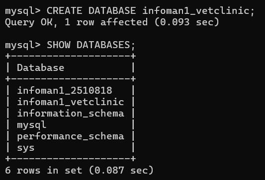
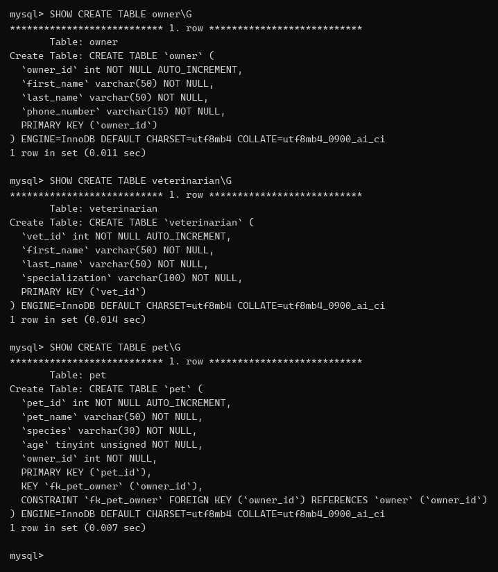
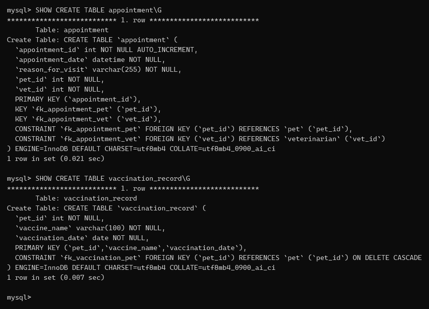
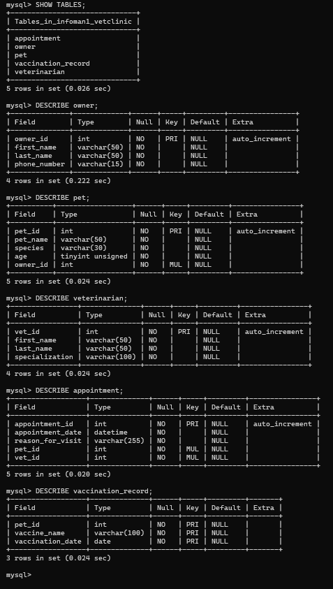
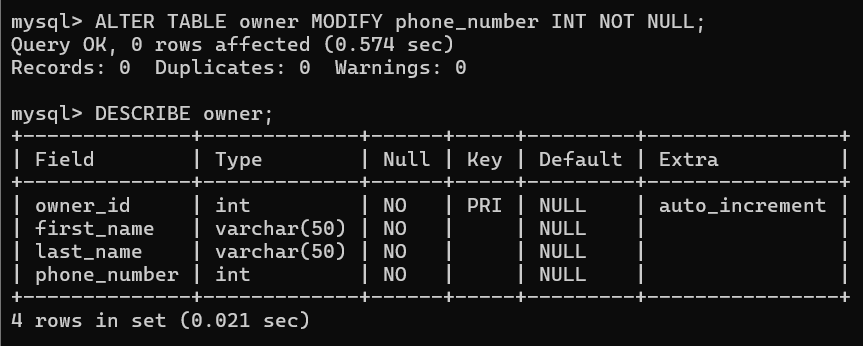
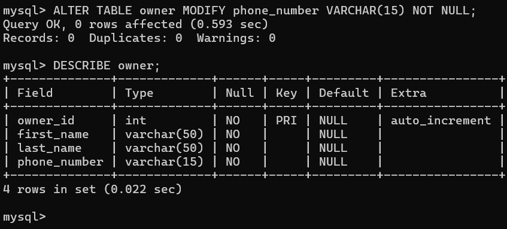

# INFOMAN1 — Week 4 Lab Answers

**Name:** Red Cyrus Oloresisimo | **Student ID:** 2510818 | **Section:** BSIT-II
**Lab:** SQL 1 (DDL & Table Creation) | **Database:** `infoman1_vetclinic`
**Script:** [vetclinic.sql](vetclinic.sql) | **Screenshots:** [screenshots/](screenshots/)

This lab implements the Week 3 veterinary clinic relational schema in MySQL:

```text
owner(owner_id PK, first_name, last_name, phone_number)
veterinarian(vet_id PK, first_name, last_name, specialization)
pet(pet_id PK, pet_name, species, age, owner_id FK)
appointment(appointment_id PK, appointment_date, reason_for_visit, pet_id FK, vet_id FK)
vaccination_record(pet_id PK/FK, vaccine_name PK, vaccination_date PK)
```

---

## Task 1 — Create the Database

```sql
CREATE DATABASE infoman1_vetclinic;
SHOW DATABASES;
USE infoman1_vetclinic;
```

**Verification:** `SHOW DATABASES;` confirms that `infoman1_vetclinic` has been created on the MySQL server.



---

## Task 2 — Create the Core Tables

```sql
CREATE TABLE owner (
    owner_id     INT AUTO_INCREMENT,
    first_name   VARCHAR(50) NOT NULL,
    last_name    VARCHAR(50) NOT NULL,
    phone_number VARCHAR(15) NOT NULL,
    PRIMARY KEY (owner_id)
);

CREATE TABLE veterinarian (
    vet_id         INT AUTO_INCREMENT,
    first_name     VARCHAR(50)  NOT NULL,
    last_name      VARCHAR(50)  NOT NULL,
    specialization VARCHAR(100) NOT NULL,
    PRIMARY KEY (vet_id)
);

CREATE TABLE pet (
    pet_id   INT AUTO_INCREMENT,
    pet_name VARCHAR(50) NOT NULL,
    species  VARCHAR(30) NOT NULL,
    age      TINYINT UNSIGNED NOT NULL,
    owner_id INT NOT NULL,
    PRIMARY KEY (pet_id),
    CONSTRAINT fk_pet_owner
        FOREIGN KEY (owner_id) REFERENCES owner (owner_id)
);
```

### Data Type Justification

| Column(s) | Data Type | Justification |
|---|---|---|
| `owner_id`, `vet_id`, `pet_id` | `INT AUTO_INCREMENT` | System-generated integer surrogate primary keys for each core entity. |
| `first_name`, `last_name`, `pet_name` | `VARCHAR(50)` | Variable-length character strings suitable for human and pet names. |
| `phone_number` | `VARCHAR(15)` | Stored as text rather than a number to preserve leading zeros, `+` country codes, and formatting. |
| `specialization` | `VARCHAR(100)` | Variable-length string large enough for descriptive veterinary specialties. |
| `species` | `VARCHAR(30)` | Short text labels (e.g., Dog, Cat, Rabbit). |
| `age` | `TINYINT UNSIGNED` | Compact non-negative integer (0–255), appropriate for animal age in years. |
| `pet.owner_id` | `INT NOT NULL` | Matches `owner.owner_id` and enforces mandatory ownership (every pet belongs to exactly one owner). |

**Primary keys defined:** `owner_id` (`owner`), `vet_id` (`veterinarian`), and `pet_id` (`pet`). `pet` is created after `owner` so its foreign key `fk_pet_owner` can reference `owner(owner_id)`.



---

## Task 3 — Create the Relationship Tables

```sql
CREATE TABLE appointment (
    appointment_id   INT AUTO_INCREMENT,
    appointment_date DATETIME     NOT NULL,
    reason_for_visit VARCHAR(255) NOT NULL,
    pet_id           INT NOT NULL,
    vet_id           INT NOT NULL,
    PRIMARY KEY (appointment_id),
    CONSTRAINT fk_appointment_pet
        FOREIGN KEY (pet_id) REFERENCES pet (pet_id),
    CONSTRAINT fk_appointment_vet
        FOREIGN KEY (vet_id) REFERENCES veterinarian (vet_id)
);

CREATE TABLE vaccination_record (
    pet_id           INT NOT NULL,
    vaccine_name     VARCHAR(100) NOT NULL,
    vaccination_date DATE NOT NULL,
    PRIMARY KEY (pet_id, vaccine_name, vaccination_date),
    CONSTRAINT fk_vaccination_pet
        FOREIGN KEY (pet_id) REFERENCES pet (pet_id)
        ON DELETE CASCADE
);
```

### Foreign Key Summary

| Child Table | Constraint Name | Foreign Key Column | References | Delete Rule |
|---|---|---|---|---|
| `pet` | `fk_pet_owner` | `owner_id` | `owner(owner_id)` | Restrict (default) |
| `appointment` | `fk_appointment_pet` | `pet_id` | `pet(pet_id)` | Restrict (default) |
| `appointment` | `fk_appointment_vet` | `vet_id` | `veterinarian(vet_id)` | Restrict (default) |
| `vaccination_record` | `fk_vaccination_pet` | `pet_id` | `pet(pet_id)` | `ON DELETE CASCADE` |

- **`appointment` (Junction Table):** Resolves the many-to-many relationship between `pet` and `veterinarian`. Both `pet_id` and `vet_id` are `NOT NULL`, enforcing the business rule that an appointment cannot exist without both a pet and a veterinarian.
- **`vaccination_record` (Weak Entity):** Uses a composite primary key `(pet_id, vaccine_name, vaccination_date)` combining the parent entity's key with the partial key. `ON DELETE CASCADE` reflects existence dependency—if a pet record is removed, its vaccination records are removed with it.



---

## Task 4 — Verify the Schema

```sql
SHOW TABLES;
DESCRIBE owner;
DESCRIBE pet;
DESCRIBE veterinarian;
DESCRIBE appointment;
DESCRIBE vaccination_record;
```

`SHOW TABLES;` confirms all five tables exist inside `infoman1_vetclinic`: `appointment`, `owner`, `pet`, `vaccination_record`, and `veterinarian`.



### `DESCRIBE` Output

#### `owner`
| Field | Type | Null | Key | Default | Extra |
|---|---|---|---|---|---|
| `owner_id` | `int` | NO | PRI | NULL | `auto_increment` |
| `first_name` | `varchar(50)` | NO | | NULL | |
| `last_name` | `varchar(50)` | NO | | NULL | |
| `phone_number` | `varchar(15)` | NO | | NULL | |

#### `pet`
| Field | Type | Null | Key | Default | Extra |
|---|---|---|---|---|---|
| `pet_id` | `int` | NO | PRI | NULL | `auto_increment` |
| `pet_name` | `varchar(50)` | NO | | NULL | |
| `species` | `varchar(30)` | NO | | NULL | |
| `age` | `tinyint unsigned` | NO | | NULL | |
| `owner_id` | `int` | NO | MUL | NULL | |

#### `veterinarian`
| Field | Type | Null | Key | Default | Extra |
|---|---|---|---|---|---|
| `vet_id` | `int` | NO | PRI | NULL | `auto_increment` |
| `first_name` | `varchar(50)` | NO | | NULL | |
| `last_name` | `varchar(50)` | NO | | NULL | |
| `specialization` | `varchar(100)` | NO | | NULL | |

#### `appointment`
| Field | Type | Null | Key | Default | Extra |
|---|---|---|---|---|---|
| `appointment_id` | `int` | NO | PRI | NULL | `auto_increment` |
| `appointment_date` | `datetime` | NO | | NULL | |
| `reason_for_visit` | `varchar(255)` | NO | | NULL | |
| `pet_id` | `int` | NO | MUL | NULL | |
| `vet_id` | `int` | NO | MUL | NULL | |

#### `vaccination_record`
| Field | Type | Null | Key | Default | Extra |
|---|---|---|---|---|---|
| `pet_id` | `int` | NO | PRI | NULL | |
| `vaccine_name` | `varchar(100)` | NO | PRI | NULL | |
| `vaccination_date` | `date` | NO | PRI | NULL | |

### Design Comparison Against Week 3 Schema & ERD

| Table | Week 3 Relational Schema | Actual MySQL Table | Matches Design? |
|---|---|---|---|
| `owner` | `owner(owner_id, first_name, last_name, phone_number)` | 4 identical columns; `owner_id` is `PRI` (`auto_increment`). | Yes |
| `pet` | `pet(pet_id, pet_name, species, age, owner_id*)` | 5 identical columns; `pet_id` is `PRI`; `owner_id` is `MUL` and `NOT NULL`. | Yes |
| `veterinarian` | `veterinarian(vet_id, first_name, last_name, specialization)` | 4 identical columns; `vet_id` is `PRI` (`auto_increment`). | Yes |
| `appointment` | `appointment(appointment_id, appointment_date, reason_for_visit, pet_id*, vet_id*)` | 5 identical columns; `appointment_id` is `PRI`; both `pet_id` and `vet_id` are `MUL` and `NOT NULL`. | Yes |
| `vaccination_record` | `vaccination_record(pet_id*, vaccine_name, vaccination_date)` | 3 identical columns; all 3 marked `PRI` (composite primary key). | Yes |

**Documented Observations / Notation Differences:**
1. **`MUL` vs. explicit FK references:** `DESCRIBE` displays `MUL` for indexed foreign key columns (`pet.owner_id`, `appointment.pet_id`, `appointment.vet_id`) rather than naming the parent table. The actual `FOREIGN KEY ... REFERENCES` constraints were verified via `SHOW CREATE TABLE`.
2. **`appointment_date` stored as `DATETIME`:** Week 3 listed `appointment_date` without a physical data type. Using `DATETIME` instead of `DATE` is an intentional physical-design refinement so clinic visits can record both date and time.
3. **No structural mismatches:** Every table name, column name, primary key, composite key, and foreign key matches the Week 3 ERD and relational schema.

---

## Task 5 — Fix a Deliberate Mistake

### 1. The Deliberate Mistake
I altered `owner.phone_number` to an inappropriate integer data type (`INT`):

```sql
ALTER TABLE owner MODIFY phone_number INT NOT NULL;
DESCRIBE owner;
```

### 2. Diagnosis via `DESCRIBE`

| Field | Type | Null | Key | Default | Extra |
|---|---|---|---|---|---|
| `owner_id` | `int` | NO | PRI | NULL | `auto_increment` |
| `first_name` | `varchar(50)` | NO | | NULL | |
| `last_name` | `varchar(50)` | NO | | NULL | |
| `phone_number` | **`int`** | NO | | NULL | |

`DESCRIBE owner;` immediately reveals `Type = int` for `phone_number`. Storing a phone number as `INT` causes real data integrity problems:
- **Leading zeros are stripped:** a local mobile number like `09171234567` loses its leading `0`.
- **Signed 32-bit overflow:** MySQL `INT` has a maximum value of `2,147,483,647`, so 11-digit mobile numbers exceed its range and fail to insert.
- **Formatting characters are rejected:** international prefixes (`+63`) and separators (`-`, spaces) cannot be stored in an integer column.
- **Not a numeric quantity:** phone numbers are string identifiers and are never used in arithmetic.



### 3. Correction Using `ALTER TABLE`

```sql
ALTER TABLE owner MODIFY phone_number VARCHAR(15) NOT NULL;
DESCRIBE owner;
```

**Corrected column definition:**
```sql
phone_number VARCHAR(15) NOT NULL
```

Running `DESCRIBE owner;` again confirms `phone_number` is restored to `varchar(15)` with `Null = NO`.

